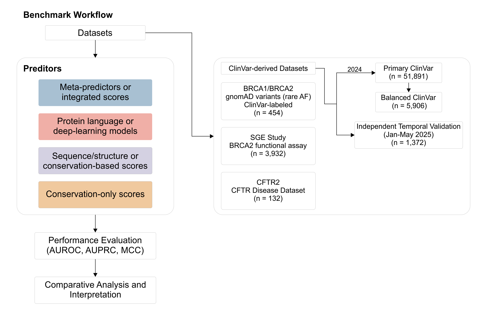
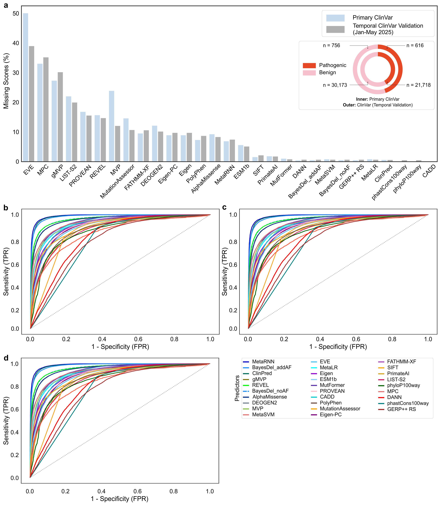
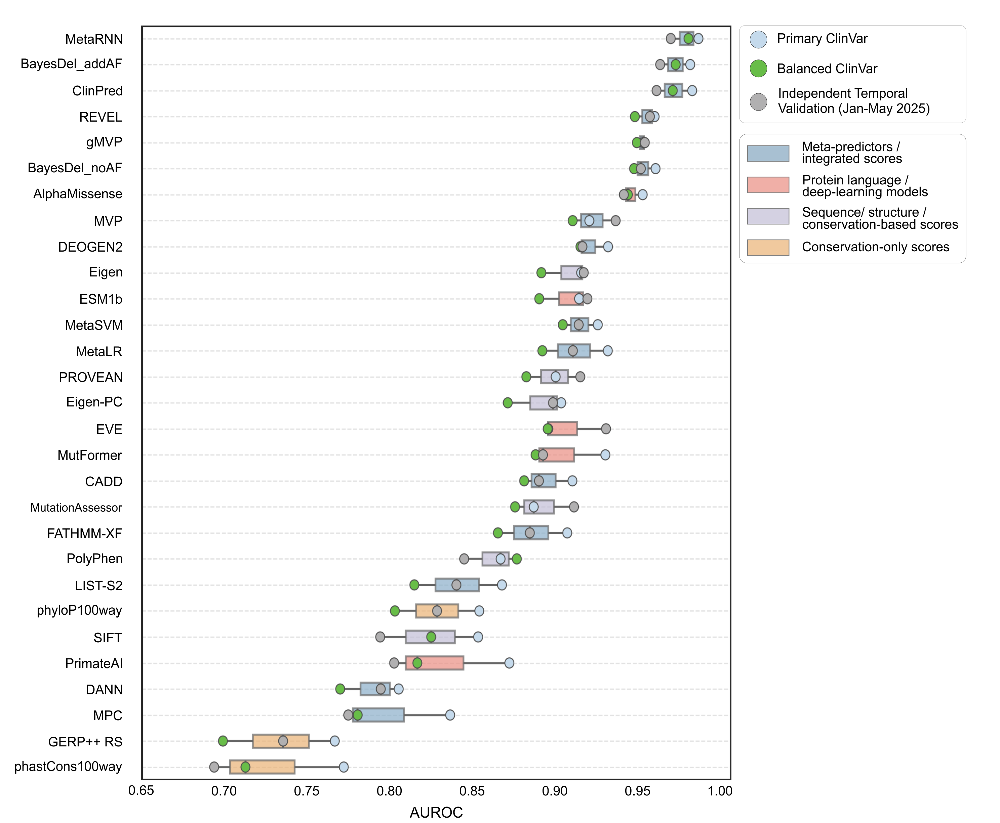
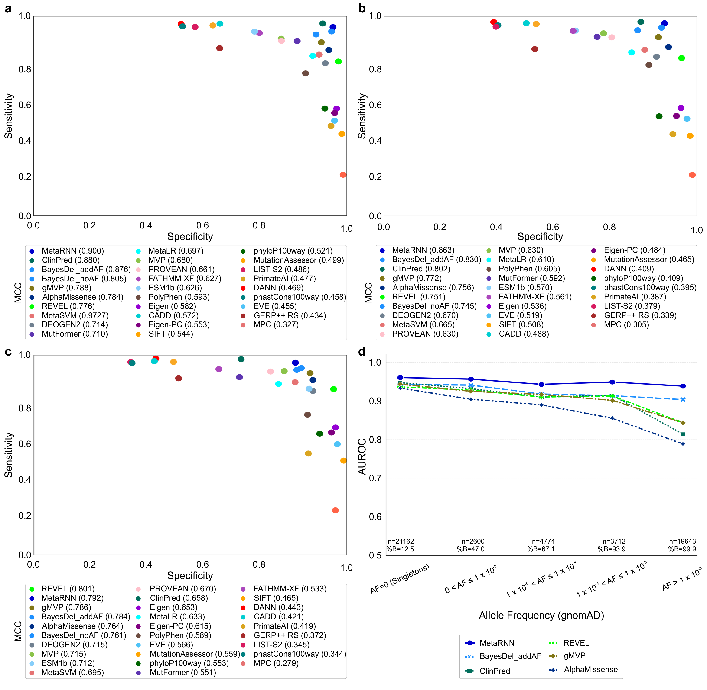
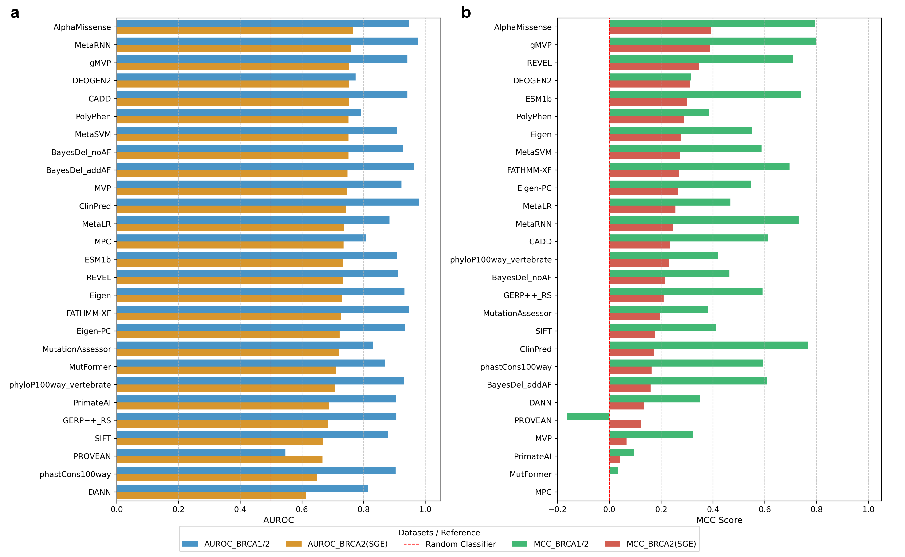

# Evaluating the Performance of Variant Effect Predictors: A Comprehensive Analysis Utilizing Clinical and High-throughput Functional Data

This repository provides the supplementary archive for the manuscript **"Evaluating the Performance of Variant Effect Predictors: A Comprehensive Analysis Utilizing Clinical and High-throughput Functional Data"**. It includes the analysis scripts and the figures and tables used in the study.

In this work, we benchmarked **29 *in silico* variant effect predictors** across multiple ClinVar-derived clinical benchmarks, gene-specific clinical datasets (*BRCA1*/*BRCA2* and *CFTR*), and a high-throughput functional benchmark from a *BRCA2* saturation genome editing (SGE) study.

## Study Workflow

## Repository contents

- `code/`: Analysis scripts for benchmarking and figure generation
- `results/figures/`: Figures used in the manuscript (high-resolution files)
- `results/tables/`: Supplementary tables with performance metrics (e.g., AUROC, AUPRC, MCC)

## Figures (preview)

| Preview | Figure | Description |
|---|---|---|
|  | **Fig. 1. Benchmarking workflow.** | Overview of dataset curation, standardized annotation, and evaluation across clinical and functional benchmarks. All variants were harmonized to **GRCh38** genome coordinates and annotated using a standardized coordinate-based workflow (Ensembl VEP, release 115). |
|  | **Fig. 2. Data completeness and ROC curves across ClinVar-derived benchmarks.** | (a) Percentage of variants lacking prediction scores in the primary and temporal ClinVar datasets; missing scores are not shown for the balanced ClinVar subset because it is a complete-case dataset by design. (b–d) ROC curves for (b) the primary ClinVar benchmark (December 2024; n = 51,891), (c) the balanced complete-case subset (n = 5,906), and (d) the temporal ClinVar validation dataset (January to May 2025; n = 1,372). |
|  | **Fig. 3. AUROC by predictor category and dataset.** | Distribution of AUROC values stratified by methodological category across ClinVar-derived benchmarks. |
|  | **Fig. 4. Threshold-based performance and allele frequency-stratified evaluation.** | (a–c) Sensitivity and specificity for each predictor at author-recommended thresholds. (d) AUROC for selected high-performing predictors stratified by gnomAD global allele frequency (AF) bins. AF-stratified results reflect both predictor behavior and AF-dependent label composition in ClinVar. |
|  | **Fig. 5. Clinical vs functional benchmarking in BRCA genes.** | Performance on a *BRCA1*/*BRCA2* clinical benchmark (n = 454) and a *BRCA2* SGE functional benchmark (n = 3,932). (a) AUROC; models are ordered by AUROC on the SGE benchmark. (b) MCC at author-recommended thresholds. |

## Supplementary tables

| Table | Content |
|---|---|
| S1 | Variant-level overlap between benchmark datasets |
| S2 | Missing prediction rates across ClinVar-derived benchmarks |
| S3 | AUROC across ClinVar-derived benchmarks |
| S4 | Threshold-based performance metrics across ClinVar-derived benchmarks |
| S5 | PPV and NPV at author-recommended thresholds |
| S6 | Allele frequency-stratified performance |
| S7 | Performance on gene-specific clinical and functional benchmarks |

## Benchmark datasets

Due to file size constraints, the full benchmark datasets are not hosted in this repository. All datasets are derived from publicly available sources described in the manuscript (ClinVar, gnomAD, CFTR2, and the *BRCA2* SGE study). Where redistribution is restricted or where derived datasets are large, curated benchmark tables can be provided upon reasonable request.

**How to request data:**
To request access, please email Syed Hassan Abbas at abbas.hassan@stu.ecnu.edu.cn with a brief description of your intended research use. The datasets will be provided in `.csv` format. In all files, the ground-truth labels are in a column named `Label` (1 = Pathogenic, 0 = Benign).

### Dataset summary

- **ClinVar-derived benchmarks:** Primary imbalanced dataset (ClinVar accessed December 2024; n = 51,891), balanced complete-case subset (n = 5,906; 2,953 pathogenic and 2,953 benign), and temporal validation dataset (ClinVar submissions January to May 2025; n = 1,372) to reduce circular evaluation.
- ***BRCA* clinical benchmark:** Rare missense variants in *BRCA1* and *BRCA2* observed in gnomAD v4.1.0 (n = 454), with clinical labels assigned from ClinVar germline classifications; common variants (AF > 1%) were excluded.
- ***BRCA2* SGE functional benchmark:** Missense variants with experimental functional labels from a saturation genome editing study of *BRCA2* (n = 3,932) [1].
- ***CFTR* benchmark:** CF-causing and non-CF-causing missense variants curated from CFTR2 (n = 132; https://cftr2.org/).

## Citation

If you find our work useful, please cite our paper:

> **Abbas SH, et al. (Year). Evaluating the Performance of Variant Effect Predictors: A Comprehensive Analysis Utilizing Clinical and High-throughput Functional Data. *Journal*. DOI: [to be added]**

## Reference

1. Sahu S, Galloux M, Southon E, Caylor D, Sullivan T, Arnaudi M, et al. Saturation genome editing-based clinical classification of BRCA2 variants. Nature. 2025;638(8050):538-45.

## Contact

For questions about the paper or data, please contact Syed Hassan Abbas at abbas.hassan@stu.ecnu.edu.cn or open an issue in this repository.
